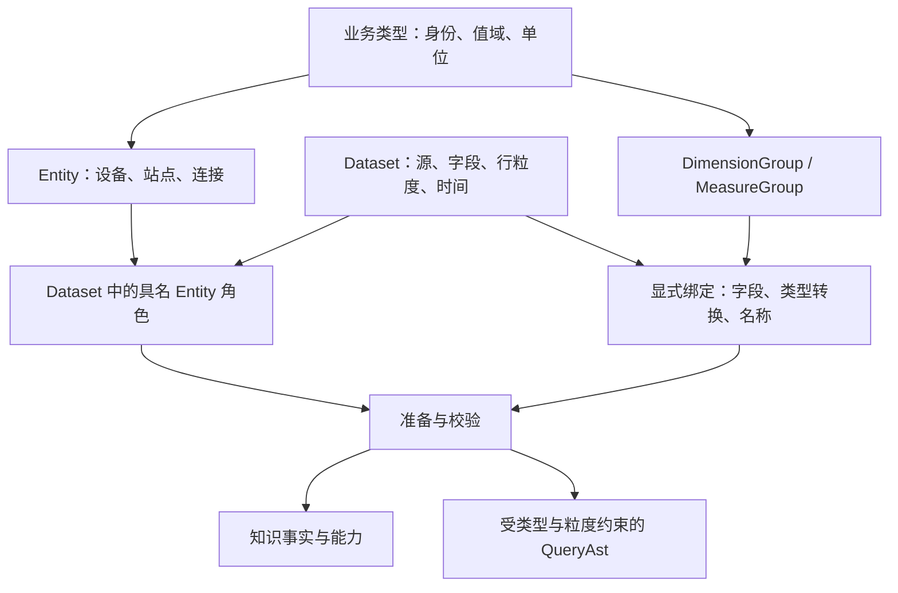

# RFC 0002：以类型约束组合模型，显式区分 Entity 与 Dataset

状态：已接受为探索方向，阶段 A 原型已完成，推进阶段 B／C 实验；公共 API 继续随实验细化。日期：2026-10-23。

当前实施范围按用户确认聚焦 transform：初始化只准备查询所需契约，暂停知识地图、info／discovery 初始化、知识导出和知识测试。
阶段验收以类型化声明、请求变换、QueryAst 与数据库执行结果为依据；下文知识发现设计保留为后续工作，不阻塞当前实现。

## 目标

让模型作者借助 Telora 的名义类型、参数化类型与构造校验表达业务约束，通过显式映射复用维度和度量。
首先在 `relation_model` 中探索作者体验与语义边界，再确定公共 API、知识契约与查询协议的演进。

本 RFC 提供未来建模的具体图景。文中的新 `model::` API 是提案记法，不是已实现接口，也不要求 Telora 增加同名语法。
本文不改变当前 `ontology`、IC 模型、服务协议或部署环境。

## 已确认的方向与待验证的方案

讨论已确认以下方向：

- 显式区分 Entity 与 Dataset，二者是独立的一等概念
- 更多借助类型系统表达约束和复用，采用 Telora newtype 承载业务类型身份
- 单位参与运算合法性检查和结果类型推导
- DimensionGroup 与 MeasureGroup 可以组合复用，应用到具体 Dataset 时允许显式配置映射

本文提出的 Entity 角色、Group 输入端口、绑定方式和实验顺序仍需评审。
Group 是否进入公共知识图、Entity 是否拥有属性定义、查询如何选择描述同一 Entity 的不同 Dataset，仍是开放设计问题。

## 问题与当前基础

当前声明以带注解的 Telora struct 为中心。`@entity_id`、`@entity_source`、`@dataset`、字段维度与度量，以及具名关系共同准备为 `PreparedPayload`。
已有 `DatasetKind` 分类和类型化字段引用，但业务对象身份、物理记录、字段能力仍集中在这套数据集声明中。

`relation_model` 中 `Device` 同时描述设备对象、`devices` 表、复合身份、可查询维度和计数。
网络设备与其他类型设备若使用不同物理字段，需要分别声明相似的维度和度量。当前度量单位使用可选字符串，不能仅由这个字符串获得量纲计算规则。

未来希望把四件事分别表达清楚：

| 层次 | 回答的问题 | 例子 |
| --- | --- | --- |
| 业务类型 | 什么值，允许什么操作 | DeviceId、Bytes、Seconds |
| Entity | 什么业务对象，如何识别 | 设备，由租户与设备 ID 共同识别 |
| Dataset | 什么记录，每行代表什么 | 设备台账、设备计数器采样 |
| Group 与绑定 | 哪组能力可复用，输入来自哪里 | 流量度量组，绑定采样列与单位转换 |

## 建模图景



以设备为例：设备 Entity 定义完整身份；台账 Dataset 提供一份当前记录；采样 Dataset 提供每设备每时刻的记录。
两个 Dataset 都绑定同一个设备 Entity，但各自声明行粒度、时间和可查询能力。查询选择哪个 Dataset，必须有明确依据。

### 第一步：用 newtype 定义身份和值

以下类型声明使用现有 Telora 语法：

```telora
type TenantId = struct(String);
type DeviceId = struct(String);
type SiteId = struct(String);
type ConnectionId = struct(String);

type DeviceIdentity = struct {
    tenant: TenantId,
    local: DeviceId,
};

type SiteIdentity = struct {
    tenant: TenantId,
    local: SiteId,
};
```

`DeviceId` 与 `TenantId` 没有隐式互转，二者与 String 之间也没有隐式包装或解包。
`DeviceId` 表示租户内设备编号的业务类型；完整设备身份是 `DeviceIdentity`，其中包含租户。
两个租户中相同的 local 值代表不同设备。名义类型区分编号种类，复合身份约束负责命名空间完整性。

源字段为 String 时，需要一个显式的源解码／绑定边界赋予其业务类型。普通 String 字段不能仅因名称相同就被推断为 DeviceId。
类型不能证明数据库实际唯一、引用一定存在或租户值一定一致，这些仍是可信模型声明与数据验收的职责。

### 第二步：独立声明 Entity

以下为候选 API 示意：

```text
Tenant = Entity {
  id: "tenant",
  identity: TenantId
}

Device = Entity {
  id: "device",
  identity: DeviceIdentity
}

Site = Entity {
  id: "site",
  identity: SiteIdentity
}
```

Entity 不持有 SQL 表名，不预设由哪个 Dataset 完整描述自己，也不因拥有身份而自动获得查询入口。
告警若具有稳定身份和生命周期，也可以声明为 Entity；事件记录集仍是单独的 Dataset。

### 第三步：让 Dataset 显式绑定 Entity 角色

```text
DeviceInventory = Dataset {
  id: "device_inventory",
  source: "devices",
  fields: {
    tenant_id: TenantId <- decode String column "tenant_id",
    id: DeviceId        <- decode String column "id",
    site_id: Option(SiteId) <- decode nullable String column "site_id"
  },
  grain: [tenant_id, id],
  roles: {
    device: Device <- {tenant: tenant_id, local: id},
    site: Optional(Site) <- {tenant: tenant_id, local: site_id}
  }
}

DeviceCounters = Dataset {
  id: "device_counters",
  source: "device_counters",
  grain: [tenant_id, device_id, ts],
  roles: {
    device: Device <- {tenant: tenant_id, local: device_id}
  },
  fields: {
    tenant_id: TenantId,
    device_id: DeviceId,
    ts: DatetimeUtc,
    rx_bytes: Bytes,
    elapsed_ms: Milliseconds
  }
}
```

字段顺序仅为展示，绑定必须在模型准备前解析完整；第二个示例省略逐列解码配置。
实验新增的采样源是合成夹具，不将它描述为现有 relation 模型或 IC 元数据中已经存在的表。

`DeviceInventory` 的一行描述一个设备，`DeviceCounters` 的一行描述一个设备的一次采样。
设备角色不是采样行身份；不能把采样行数直接解释为设备数。没有已声明全行粒度的 Dataset 仍可支持有依据的行查询，但不能取得依赖该证明的能力。

可选角色在完整身份所有成员均非空时才可用；任一成员为空代表角色缺席，不创建“NULL 实体”。
角色映射只描述记录涉及哪个对象，不证明对象在某台账中存在，也不自动授权连接。

Dataset 可以绑定多个不同或同类 Entity，也可以不绑定 Entity，例如匿名统计汇总。
若两个 Dataset 声称描述同一个 Entity，准备阶段能校验身份类型与映射完整性；其数据一致性和时态一致性仍需额外声明与验收。

### 第四步：定义可复用的 DimensionGroup

```text
ResourceIdentityDimensions(E) = DimensionGroup {
  requires: role subject: E,
  members: {
    identity: subject 的完整身份投影
  }
}

ResourceLabelDimensions = DimensionGroup {
  inputs: {name: String, category: ResourceCategory},
  members: {
    name: Dimension(name, projectable, filters=[Eq, Contains]),
    category: Dimension(category, projectable, filters=[Eq])
  }
}
```

台账绑定示例：

```text
DeviceInventory.use(ResourceIdentityDimensions(Device), {
  subject: roles.device,
  publish: {identity: ["device_tenant_id", "device_id"]}
})

DeviceInventory.use(ResourceLabelDimensions, {
  inputs: {name: fields.display_name, category: fields.device_class},
  publish: {name: "device_name", category: "device_class"}
})
```

Group 的输入名称、业务成员名称、具体发布 ID 与物理列名分别管理。
完整身份投影对复合身份展开为多个有序成员，不能把它缩成单列；具体公共表示需由实验确定。
另一种分类不能只因底层也是 String 就绑定 ResourceCategory，需要显式、可校验的转换；不提供任意按标签猜测的映射。

没有分类的 Dataset 可以只使用身份组或较小的名称组。优先通过小 Group 组合表达差异；可选输入必须有明确的缺失语义，不能静默删除成员。

### 第五步：以单位类型约束 MeasureGroup

以下是候选库类型，采用 Telora 参数化 newtype 的形状：

```telora
type Quantity(Meaning, Unit, Rep) = struct(Rep);
```

Meaning 表达测量对象或业务数量种类，Unit 表达量纲、尺度与允许的换算，Rep 表达基础表示。
具体设计需要验证 Telora 对这些类型参数的反射与约束能力；仅有类型参数尚不能自动推导单位代数。
Bytes、Seconds 等名称在下文代表已选定的具体数量类型，最终使用类型族应用还是具名外包装由实验决定。

```text
TransferMeasures = MeasureGroup {
  inputs: {
    amount: Bytes,             // 本采样区间内传输的数据量
    elapsed: Seconds          // 相同采样区间内的有效时长
  },
  row_values: {
    rate: amount / elapsed -> BytesPerSecond
  },
  members: {
    amount_total: Sum(amount),
    rate_peak: Max(rate),
    rate_mean: Avg(rate)
  }
}

DeviceCounters.use(TransferMeasures, {
  inputs: {
    amount: fields.rx_bytes,
    elapsed: milliseconds_to_seconds(fields.elapsed_ms)
  },
  publish: {
    amount_total: "rx_bytes_total",
    rate_peak: "rx_rate_peak",
    rate_mean: "rx_rate_sample_mean"
  }
})
```

Group 固定聚合及统计意义，绑定适配字段和单位。`rate_mean` 是逐采样速率的算术平均，不能改称区间总体平均速率。
若要定义 `Sum(amount) / Sum(elapsed)`，应单独声明度量，并给出样本区间不重叠、有效时长等总体前提；计数器累计读数也不能冒充区间传输量。
固定 amount_total 的 Sum 并不自动授权任意跨连接聚合，查询仍需证明样本粒度未被扩增。

同一 Group 可以映射另一个 Dataset 的 `bytes_in`、`duration_seconds`，得到同样的业务计算。
两次绑定的成员拥有各自 Dataset 限定身份，不能因为来自同一 Group 就自动连接或对齐结果。

## 类型如何表达可计算性

### 语言能力与 ontology 责任

Telora 当前支持 `type A = struct(B)` 的名义身份、显式构造与解包、参数化类型族，以及 `@check` 构造校验。
JSON codec 对 newtype 使用载荷表示，成功解码后保留外层类型身份。语言依据见 Telora 的
`docs/design/LANGUAGE.md` 第 7 节与 `guide/TELORA.md` 的 newtype 说明；这些文档属于 Telora 项目，不在本仓复制维护。

ontology 需要提供业务类型与物理标量的显式表示映射，以及带输入／输出类型的封闭表达式构造器。
例如 `divide(BytesExpr, SecondsExpr) -> BytesPerSecondExpr` 表示待查询计算，而不是先读数据库值到 Telora 再计算。
普通 newtype 值运算可以验证类型方向，但不等于已经支持相应 SQL lowering。

首轮实验优先提供少量具名运算与转换，验证机制；通用量纲代数和自动选择换算路径留待后续设计。
不能依赖未核实的运算符重载、关联类型或编译期任意算术能力。

### 单位规则与业务规则

| 表达式 | 候选规则 |
| --- | --- |
| Bytes + Bytes | 返回 Bytes |
| Bytes + Kilobytes | 显式转换到共同单位后相加 |
| Bytes / Seconds | 返回 BytesPerSecond，明确零时长处理 |
| Watts × Seconds | 返回 Joules，业务意义还取决于功率值和区间定义 |
| Watts + Seconds | 拒绝，量纲不兼容 |
| CPU 利用率与内存利用率相加 | 单位兼容仍不足以授权运算，需要业务数量种类的规则 |
| 百分数 25 与比值 0.25 比较 | 经显式尺度转换后比较，不能只去掉 `%` 字符串 |

单位定义至少记录量纲、相对于选定基准的尺度及编码规则。KB 的 1000 与 KiB 的 1024 必须显式区分。
首轮支持线性尺度转换；摄氏温度等含偏移的单位、时间积分和采样插值留作后续主题，不以简单乘法近似。
声明合法单位的权威性来自模型作者，量纲和转换规则由库约束；类型系统不能从一个任意标签证明真实单位。

换算的整数溢出、精度损失、近似浮点计算和除零行为必须进入运算契约。实验以精确可表示的输入验证尺度，并为不支持的组合给出拒绝。
newtype 的构造检查可以约束百分比范围或非负时长，但不能单凭声明保证数据库已存数据有效。
数据库输入验收、参数解码、生成 SQL 和输出解码分别承担各自边界；完整结果集上的构造检查不能被客户端抽样代替。

### 聚合与空值

Min／Max 保留输入数量类型；Avg 与 Sum 保留业务数量和单位，但基础数值表示与溢出策略单独决定。
空聚合可能产生 NULL，结果类型必须保留这一可能，例如 `Option(BytesPerSecond)`；不能只因输入 newtype 非空就声明聚合结果非空。
Count 的值是数量，但计数主体、实体去重和记录计数仍需明确。单位不能证明任何聚合在业务上合理。

## Group 的组合与绑定边界

Group 定义输入端口的类型、成员 ID、表达式、聚合语义与能力上限；一次绑定给出输入映射、实体角色和输出成员的发布 ID。
输入可以是当前 Dataset 的带类型字段或封闭计算表达式。首轮不允许在绑定中隐式引入跨 Dataset 查询。

| 可配置项 | 约束 |
| --- | --- |
| 字段与角色映射 | 输入类型兼容，角色的完整身份成员齐全 |
| 单位或编码转换 | 使用显式受支持转换，保留转换事实 |
| 发布 ID、描述和标签 | ID 在所属命名空间唯一，标签不承担身份 |
| 能力裁剪 | 可降低允许的筛选／投影能力，不扩展 Group 或 Dataset 的上限 |
| Group 组合 | 成员显式合并与重命名，依赖可解析且无环 |

绑定不允许把 Avg 覆盖为 Max、把 Bytes 标成 Watts、把相同显示名当实体身份，或通过配置添加未声明关系。
不同聚合应成为显式成员或不同 Group。重复发布 ID、缺失端口、循环依赖与类型冲突都应定位到 Group 定义和绑定位置。
同一 Group 可以绑定两次，如接收／发送流量，前提是各次输入、成员身份和发布名称明确。

## 关系、角色与计数

关系需要区分业务对象关系与具体 Dataset 上的实现路径。首轮保留当前具名关系与可信基数契约，增加类型与角色校验。
不根据两列具有相同 newtype 就推断可以连接，也不根据完整身份连接键自动证明运行时基数。

relation 实验中的连接记录可表达为：

```text
ConnectionRecord {
  connection: Connection <- {tenant: tenant_id, local: id},
  a: Device <- {tenant: tenant_id, local: a_device_id},
  z: Device <- {tenant: tenant_id, local: z_device_id}
}

connected_device: Undirected(a, z)
upstream_device: Directed(a, z)   // 在独立 RouteRecord 上声明
```

A/Z 是具名 Entity 角色，二者同为 Device 类型，但角色身份不同；方向来自显式业务连接声明。
缺 tenant 的设备身份映射失败；把 SiteId 绑定到 DeviceId 端口失败。即使所有类型正确，反向遍历有向关系仍应拒绝。

同一 Entity 在多个 Dataset 中出现时，不选择隐式“主表”，不自动跨源合并、去重或取最新。
首轮实验请求保留明确 Dataset 实例与角色选择；实体检索、多来源融合和时态属性解析另行设计。
实体计数需要完整身份以及结果去重／粒度证明；记录计数需要 Dataset 行粒度。两者不能仅通过名称替换互相迁移。

## 准备、发现与查询边界

候选准备流程如下：

1. 注册业务类型、Entity、Dataset 和可复用 Group
2. 解析字段表示、完整身份、具名角色与关系，检查静态类型及声明一致性
3. 展开 Group 绑定，固定成员 ID、类型、单位转换及表达式依赖
4. 将语义描述降为可供查询和知识发现共享的准备模型
5. 转换具体查询时继续校验权限、关系、总体、粒度、时间与目标后端能力

编译器可证明的名义类型错误尽量在编译时拒绝；通过 Type 元数据和动态声明构造的错误在模型准备时拒绝；查询总体等依赖请求的错误在 Intent 转换时拒绝。
跨行唯一性、外键完整性、实际值域和声明基数由数据验收验证。诊断必须指出属于哪一个阶段，不能统称为“类型安全”。

知识发现需要表达 Entity 与 Dataset 的区别、角色的身份映射、数量类型、单位和转换，以及 Group 绑定后可查询的成员。
公共知识仍只发布可见成员；Group 的私有输入和隐藏身份不能因为组合而泄露。
Group 是否发布为可寻址节点仍待讨论；无论选择何种形态，查询所需的展开成员和计算语义必须可发现。

现有 QueryAst 采用封闭运算。新类型在准备和表达式构造期间保留语义，在后端渲染前形成带明确数值转换的受支持 AST。
不将任意 Telora Fn 或 SQL 字符串作为字段映射接受。每个后端需要执行验证，不能只凭类型签名声称已支持单位计算。

当前 JSON Intent 的基础值形状不因使用 newtype 就必然改变。身份角色、类型 ID、结果单位和 Dataset 选择若影响外部契约，须版本化设计后再迁移。
本 RFC 不提前决定新请求字段、知识键模式或兼容期，不把新 Entity ID 直接覆盖旧 Dataset ID。

## 用 relation_model 探索

### 阶段 A：类型基础与映射原型

在独立实验模块与测试中声明 TenantId、DeviceId、SiteId 和复合身份，验证语言已有的名义类型、JSON codec 与构造检查。
提出最小 Entity／Dataset／Role 描述与带类型字段映射；运行准备阶段的正反例，保留现有 relation 服务和测试作为基线。

### 阶段 B：Group 与单位计算

新增小型合成计数器采样夹具，两个 Dataset 使用不同物理列名和秒／毫秒表示，绑定同一个 TransferMeasures。
DimensionGroup 先覆盖身份投影及可选的名称组；MeasureGroup 先覆盖逐行速率、Sum、Max 和 Avg。
验证 Group 的重复应用、成员命名、能力裁剪、可空性和单位转换；不从这项实验推导 IC 生产语义。

### 阶段 C：关系与端到端查询

把 Tenant、Site、Device、Connection、Route 的实验声明映射到当前五张关系模型表。
保留当前复合身份、有向／无向业务连接、EXISTS 粒度保护和空组计数语义。
以小型 SQLite 数据验证新声明和基线声明的等价查询结果，再逐步覆盖知识发现和结果模式。
试验稳定后单独提出公共契约和 IC 迁移方案；RFC 批准不等于已经批准替换演示环境。

### 验收图景

| 正例 | 对应反例或必须解释的边界 |
| --- | --- |
| 两个不同列名的 Dataset 绑定同一 Group，得到同义度量 | 输入缺失或名义类型错误，绑定失败 |
| 完整 DeviceIdentity 绑定设备角色 | 只给 DeviceId 或把 SiteId 用作 DeviceId，失败 |
| 相同本地编号的两个租户设备保持独立 | 按本地编号错误合并实体，不得通过 |
| Connection 的 a、z 各自绑定完整设备身份 | 同为 Device 类型不代表可交换有向角色 |
| 1000 Bytes / 1000 Milliseconds 经显式转换得 1000 BytesPerSecond | 未转换却把毫秒当秒，拒绝不兼容输入 |
| 逐样本速率 Avg 与总量／总时长得到各自正确结果 | 非均匀时长夹具中两种均值不同，不能混称 |
| 两次应用 Group 分别生成接收／发送指标 | 发布 ID 冲突、循环依赖或聚合被绑定覆盖，失败 |
| 缺席的可选站点角色保持缺席 | 用 NULL 身份建立共享站点，失败 |
| 空样本集上的 Avg 返回可空数量结果 | 将结果声明为必定非空，失败 |
| Typed Expr 经转换后生成参数化 SQL，执行结果单位正确 | 任意 Fn、原始 SQL 或未支持后端不得绕过校验 |
| 所有原 relation 验收继续成立 | 类型化声明不能放宽基数、方向或可见性约束 |

额外记录准备耗时、函数数、Wasm 代码段与快照大小。类型和 Group 展开可能增加专门化实例，性能结果要实测；本次设计不承诺自动缩小产物。

## 评审问题与实施顺序

建议先确认概念和作者体验，再收敛语法与实现：

1. Entity 只定义身份，还是也声明业务属性；属性由多个 Dataset 提供时如何区分来源与时间
2. Group 是声明复用工具，还是公开的一等知识概念；是否需要跨 Dataset 的 Group 成员稳定身份
3. 首轮数量类型采用具名类型加显式运算表，还是直接引入参数化 Quantity 与能力约束
4. 映射描述是否分别表示类型赋予、源解码、单位换算与纯计算，以便发现和诊断完整解释
5. 角色和 Entity 在公共查询中如何寻址，怎样避免自动选择数据源改变用户总体

建议首轮只落地可执行的 relation 原型，使用具名数量类型与少量显式转换验证端到端流程。
若现有 Telora 能力不足，先记录最小缺口；是否需要语言层演进另行论证，不在 ontology 中模拟未证明的类型系统能力。

本 RFC 单独交付。阶段 A 在独立实现分支推进，实验结论反馈到本文；后续阶段确认范围后继续实施。
各阶段按范围选择语言拒绝测试、模型准备测试及数据库执行验收，提交与合入遵循仓库交付规则。

## 参考

- [当前模型声明与准备契约](../ontology/docs/ONTOLOGY.md)
- [字段角色与唯一引用](../ontology/docs/FIELD-ROLES.md)
- [查询 AST 边界](../ontology/docs/QUERY.md)
- [逻辑类型](../ontology/docs/LOGICAL-TYPES.md)
- [relation 模型声明](../relation_model/src/model.telora)
- [relation 验收语义](../relation_model/ACCEPTANCE.md)

## 阶段 A 实验记录

统一跟踪议题为 [#64](https://github.com/hh9527/lab-ontology/issues/64)，各阶段在同一议题汇报，不另建阶段议题。

原型入口为 `ontology::experimental::model`，独立于当前 `ontology::ontology` 准备与服务协议。
可执行示例见 [relation 测试夹具](../relation_model/tests/typed_model/fixture.telora)，正反例见
[typed_model 测试](../relation_model/tests/typed_model.telora)。

作者可使用以下实际原型 API 表达映射：

```telora
use ontology::experimental::model as model;

type TenantId = struct(String);
type DeviceId = struct(String);
type DeviceIdentity = struct { tenant: TenantId, local: DeviceId };
type Inventory = struct { tenant: TenantId, device: DeviceId };

def device: model::Entity(DeviceIdentity) = model::entity("device", DeviceIdentity.type);
def inventory: model::Dataset(Inventory) = model::dataset(
    "inventory", "devices", Inventory.type, ["tenant", "device"]);
def subject: model::Role(Inventory) = model::role(inventory, device, "subject", False, [
    model::identity_part(model::field(Inventory.type, TenantId.type, "tenant"),
        model::field(DeviceIdentity.type, TenantId.type, "tenant")),
    model::identity_part(model::field(Inventory.type, DeviceId.type, "device"),
        model::field(DeviceIdentity.type, DeviceId.type, "local")),
]);
```

静态泛型签名约束字段值类型、Dataset 行类型和 Entity 身份类型；准备阶段检查字段存在、完整身份覆盖、重复成员、可空性和冲突角色。
同一个 Entity 可映射到不同字段名与行粒度的 Dataset，同一个 Dataset 可具有设备 a／z 两个角色，Dataset 也可不绑定 Entity。
newtype 的原始 JSON 编码与构造校验已经在这个模型上下文中验证；没有将其等同于数据库已有值的验收。

原型取舍与限制：

- 身份暂要求非空 record，成员为 Int、String 或它们的 newtype 包装；单值身份用一成员 record 表达，后续再验证直接 newtype 身份
- Dataset 粒度与实体身份分开，空 grain 表示没有声明全行身份；实验不据此授予计数能力
- `optional_field` 在类型化构造时要求精确的 `Option(Value)`；角色描述擦除类型参数后，准备层按 None／Some 的完整结构检查可空输入
- 原型的公开 record 不是不可伪造证明；手写声明仍经过准备校验，后续完善擦除边界的表示与名义 Option 证据
- `prepare` 只处理单个 Dataset，跨 Dataset 的 Entity 注册和一致性校验留待组合准备阶段
- 本阶段只准备模型事实，不生成知识节点、查询 AST、SQL，也不迁移现有关系模型服务

`scripts/check-typed-model-rejections.py` 在独立临时工作区运行合法控制例和编译期拒绝例，覆盖名义值、映射值类型、行拥有者、实体身份和单位运算。
失败源码不加入普通测试发现路径，因此正常的 `check --tests` 不会因预期编译失败夹具而失败。

## 阶段 B 单位计算实验

实际入口为 `ontology::experimental::quantity`，当前以具名 newtype 和封闭的函数签名验证单位计算，尚未实现通用量纲代数。

```telora
use ontology::experimental::quantity as q;

# 显式换算后，结果为 Some(BytesPerSecond(1.5))
q::rate(q::Bytes(3.0), q::seconds(q::Milliseconds(2000.0)))
```

`rate(Bytes, Seconds)` 返回 `Option(BytesPerSecond)`，毫秒直接传入、字节与秒相加、将速率结果声明为字节都会在编译期拒绝。
数量使用 Float 负载，JSON 保留数值表示；物理源数据的单位真实性仍需在 Dataset 绑定边界验证。

实验明确两个聚合口径：`mean_rate` 是有效样本速率的算术平均，`weighted_rate` 是有效样本累计量除以累计时长。
例如 `(100 B, 1 s)`、`(900 B, 9 s)`、`(100 B, 10 s)` 分别得到 `70 B/s` 和 `55 B/s`。
非正时长样本在这两个实验聚合中都排除，空集或全无效样本返回 None；有效时长上的零字节仍得到零速率。

这部分确定了单位与聚合语义的最小可执行基础。下述 Group 实验将这些语义连接到字段绑定与数据库计算。

### 已实现的 Group 原型

实际入口为 `ontology::experimental::groups`。完整作者示例见 [Group 夹具](../relation_model/tests/typed_groups/fixture.telora)，该示例使用独立的合成采样表。
下面是从夹具提取的实际 API 形状：

```telora
use ontology::experimental::model as m;
use ontology::experimental::groups as g;
use ontology::experimental::quantity as q;

type Sample = struct { seq: Int, rx: Option(q::Bytes), elapsed_ms: Option(q::Milliseconds) };
def samples: m::Dataset(Sample) = m::dataset("samples", "samples_ms", Sample.type, ["seq"]);
def rx: g::Binding(Sample) = g::transfer_binding(samples, g::transfer,
    g::input(m::optional_field(Sample.type, q::Bytes.type, "rx")),
    g::seconds(g::input(m::optional_field(Sample.type, q::Milliseconds.type, "elapsed_ms"))), [
        {member: g::TransferMember::AmountTotal, publish: "rx_total"},
        {member: g::TransferMember::RatePeak, publish: "rx_peak"},
        {member: g::TransferMember::RateMean, publish: "rx_mean"},
    ]);
```

流量模板固定 Sum(amount)、Max(rate) 和 Avg(rate)，绑定参数没有覆盖聚合算子的入口。
另一份 Dataset 使用 `bytes_in` 与 `duration_seconds`，直接绑定秒类型字段；同一 Dataset 再绑定发送字节字段，显式发布 `tx_*` 成员。
表达式类型参数约束行拥有者和数量类型；输入可空性在描述中独立保留，所有实验聚合结果都声明为可空。
准备层同时重检公开描述中的输入类型、完整组成员、聚合口径、源拥有者、输出可空性和发布 ID 唯一性。

`dimension_group` 定义具有一个类型化输入的小型可复用维度组，通过多个 `Binding(Row)` 显式组合名称、分类和度量。
绑定可以裁剪投影和筛选能力，准备层拒绝超过定义上限的配置；当前单源查询只执行投影与聚合，筛选能力仍是准备事实，筛选请求编译留待关系查询集成。
`identity_dimensions` 将 Entity 角色的完整身份展开成多个成员，要求每个身份成员都有显式发布映射。
可选身份任一输入为空时，全部身份投影均为 NULL。聚合时允许出现缺席角色的 NULL 分组，它是记录分组，不代表存在一个共享的 NULL Entity，也不授予实体计数能力。

封闭表达式当前只有字段、毫秒换秒、逐样本速率和完整身份投影；没有任意函数或 SQL 字符串入口，也没有按名称引用其他 Group 成员的依赖边。
因此跨 Group 依赖与循环目前无法表达；后续若开放成员引用，需要单独增加依赖图及循环检查。
lowering 复用公共 QueryAst；速率在时长非正或缺失时返回 NULL，并主动进行浮点除法，避免 SQLite 整数存储带来截断。
`amount_total` 汇总全部非空字节值，包括时长无效的记录；速率聚合只使用字节与有效时长均存在的记录。总体加权速率仍是单独的业务口径，没有混入此模板。

执行验证覆盖两种列名／时间单位、接收／发送重复应用、复合身份、非均匀时长、可空字段、非正时长、空输入与整数存储。
SQLite 查询已实际执行；PostgreSQL 仅验证生成和参数一致性，尚未在 PostgreSQL 数据库执行。
数值负载和 source 声明仍是可信输入边界，实验不将类型化字段声明等同于数据库值域、唯一性或引用完整性的证明。
当前模板是流量组与小型维度组的封闭实验，不代表通用的 Group 声明 API 已定稿。

验收命令：

```sh
bin/telora -C relation_model test typed_groups --request-fuel 100000 --with-memory-limit 1024
bin/telora -C relation_model eval @test/typed_groups:runtime_cases --request-fuel 100000 --with-memory-limit 1024 > "$TMPDIR/typed-groups-queries.json"
node relation_model/tests/typed-groups-runtime.mjs "$TMPDIR/typed-groups-queries.json"
python3 scripts/check-typed-model-rejections.py
```

## 阶段 C：类型化关系接入 transform

`ontology::experimental::relations` 通过显式 Dataset 和具名 Entity 角色声明关系。
每一端先验证完整身份，两端必须指向同一 Entity ID 和同一身份类型；连接键由对应身份成员展开，不接受请求覆盖连接键。
业务连接由两个不同的 hub 角色、一个明确的参与者 Dataset 和显式方向构造，物理端点位置不承担方向推断。
多个完整角色映射可以显式组成备选关系，备选分支各自保留租户与本地身份。

五张现有关系表的可执行映射见 [typed_relations](../relation_model/src/typed_relations.telora)。
该实验的 Entity ID 使用 `device_entity` 等名称，Dataset ID 仍使用 `device` 等现有 transform 地址，二者拥有独立含义。
当前 JSON Graph 中历史字段 `entity` 在此适配实验中仍寻址 Dataset；新 Entity ID 不自动成为查询入口。

首个桥接步骤复用旧 transform 的维度、计数声明和 profile，将关系键与业务方向改由新角色声明生成。
桥接时校验物理源、字段编码、可空性及完整 Dataset 粒度与原 transform 结构一致，防止借用不同粒度上的计数证明。
声明基数仍是可信模型契约，角色的名义类型和完整连接键不等同于数据库外键或基数证明。
准备层还检查跨关系的 Entity 身份一致性、Dataset 声明一致性、具名角色映射一致性和关系 ID 唯一性。
公开的已擦除描述经过 `validate_prepared` 重检，不作为不可伪造证明。

验收以 transform 为依据：13 个新正反例覆盖身份、来源、角色、重复 ID、注册边、方向及扩增计数拒绝；
隔离工作区将现有 graph 测试显式切换到新关系载荷，102 个用例通过。
六组真实生成 SQL 在同一 SQLite 数据上与旧声明及独立期望值比较，覆盖复合租户身份、A/Z、有向／无向业务连接、EXISTS 粒度、空组和备选端点计数。
源数据包含跨租户同 ID、重复连接、缺失端点、孤立租户与自连接，不能仅靠新旧实现一致来判定正确。

```sh
bin/telora -C relation_model test typed_relations --initialization-fuel 100000 --request-fuel 100000 --with-memory-limit 1024
python3 scripts/check-typed-relations.py
```

这一桥接步骤通过后，继续推进下述独立准备入口；IC 类型化迁移仍在后续阶段。
知识地图、知识发现与知识测试按用户要求延后，不作为本阶段的交付或评价依据。

### 独立 Dataset／成员准备与服务接入

`ontology::experimental::transform::declare` 接受一个带 Row 类型的 Dataset、具名角色、同 Row 的 Group 绑定和显式记录计数发布 ID。
擦除后的绑定保留定义契约，组合边界通过 `prepare_facts` 重检类型、能力、成员完整性和可空性。
`transform::build` 从这些声明独立生成原有 transform 编译器所需的准备结构，并要求每个关系端点都匹配已登记 Dataset 的具名角色；关系不能私下改写角色映射。
关系、备选关系和业务连接显式注册，公共边 ID 冲突在初始化时拒绝。

relation 模型的五张表、三个可查询维度、记录计数、九条关系和两条业务连接均已由新声明独立准备，不读取基线模型的注解或载荷。
MainService 的 transform 入口使用这份载荷，旧模型仅保留为验收基线。
查询接口仍沿用现有 Graph 的 Dataset 寻址与基础值表示；内部适配结构中的历史 EntityEntry／DatasetKind 命名不改变新声明中 Entity 与 Dataset 的独立身份。

Dataset Row 中的名义类型保留在声明与准备模型中，SQL 字段表示由 newtype 负载显式展开到 Int、Float、Bool 或 String。
可空字段保留 NULL 能力，嵌套 Option 因无法在单 SQL 列区分缺失层次而拒绝。
返回给现有宿主的结果列继续使用物理结果类型与 nullable 标记，例如 Option(Label) 对应可空 String，Bytes 对应 Float；这不等同于已发布单位／名义结果类型的新外部契约。

记录计数必须有非空 Dataset grain，计数列来自声明的非空粒度字段，不授予不同 Entity 角色上的隐式去重计数。
跨 Dataset 同一 Entity ID 的身份类型必须一致；Group 成员 ID、计数 ID、Dataset ID 和公共边 ID 分别按 transform 契约检查唯一性。
共享的 `validate_transform_contract` 校验投影、筛选、聚合和 scope 的执行能力，独立入口额外检查源能力；不执行知识目录或知识地图校验。

此入口支持物理列维度、计算维度、完整身份投影、Group 聚合度量与记录计数。Group 度量使用共享 QueryAst 聚合路径，支持 Graph 投影及相关 EXISTS 的 HAVING。
独立准备的 18 个正反例与结果列检查、现有 102 个 graph 用例、六组 SQLite 等价查询和临时快照的批量 transform 验收通过。
快照验收同时执行生成 SQL，核对跨租户记录、物理列类型和整批原子拒绝行为。

```sh
bin/telora -C relation_model test typed_preparation --initialization-fuel 100000 --request-fuel 100000 --with-memory-limit 1024
python3 scripts/check-typed-relations.py
```


### Graph 计算维度与可空身份投影

独立准备入口复用 Group 的封闭表达式 lowering，将 Seconds、Rate 和 Identity 节点编译为现有 QueryAst 标量表达式。
维度准备结构的字段索引只作为输入锚点；查询表达式保留全部输入列，并通过现有 Graph 实例重定位机制适配请求中的节点别名。
计算维度的投影和筛选均受 profile 约束，筛选专用的隐藏维度同样检查完整计算表达式所需能力。

身份 Group 在角色任一分量缺失时，所有公开分量返回 NULL，避免将不完整身份的租户部分误认为有效身份。
速率沿用 Bytes／Seconds 的语义：时长为零、负值或缺失时返回 NULL，零流量与有效正时长得到零速率。
返回列继续使用现有物理类型与 nullable 标记。

三个针对性测试验证结果类型与能力拒绝；SQLite 实际执行覆盖单位换算、正负零时长、缺失输入、完整／不完整身份、跨租户局部同名身份、计算维度筛选、节点别名和空输入。
现有 102 个 graph 用例和六组 SQLite 等价查询同时通过。

```sh
bin/telora -C relation_model test typed_dimensions --initialization-fuel 100000 --request-fuel 100000 --with-memory-limit 1024
python3 scripts/check-typed-dimensions.py
```


### Graph Group 度量聚合

`MeasureEntry.row_expression` 描述聚合前的逐行表达式，并携带表达式输出的物理类型。
它与聚合后依赖其他度量的 `computed` 分开：`Avg(Rate(Bytes, Seconds))` 在每条样本上先计算合法速率，再对非 NULL 结果取平均，不改写为总流量／总时长。
注解模型的普通字段度量保持 `row_expression: None`。

独立准备入口将 Group 成员按维度和聚合度量分开准备。
同一 Transfer Group 可重复发布为接收、发送指标，也可绑定到不同列名和时间单位的 Dataset。
聚合输入在实际 Graph 实例的 Source 上生成，参数分配继续沿用当前 BuildCtx；聚合投影和相关 EXISTS 的 HAVING 使用同一逐行表达式入口。
Sum、Max、Avg 的返回列保留可空性，空集返回 NULL；记录计数仍单独声明。
表达式的结果类型独立于锚定输入字段，避免把计算结果误解释成源字段的时间或其他语义。

初始化同时检查聚合函数和输入表达式所需的标量能力。
现有 Graph 粒度证明保留：多个样本分支导致度量样本可能重复时拒绝，相关聚合使用独立 owner Dataset 与明确的角色映射。
聚合度量、维度与记录计数的发布 ID 继续按既有规则检查冲突。

验收通过：Group 模块 23 个测试；四组独立查询与五组 Graph 查询实际 SQLite 执行；102 个现有 graph 用例与六组新旧关系等价查询；ontology 的 profile 19 例、结果列 8 例及 Latest 11 例。
五组 Graph 查询覆盖两个单位布局中的重复 Group、分组／总体聚合、可空身份、无效／缺失输入、空集、无 affinity 整数存储及相关 EXISTS 中的平均速率筛选。
非均匀时长夹具仍得到逐样本平均速率 70，不能替换为总量／总时长的 55。

```sh
bin/telora -C relation_model test typed_groups --initialization-fuel 100000 --request-fuel 100000 --with-memory-limit 1024
python3 scripts/check-typed-groups.py
```

阶段 C 的关系与端到端 transform 目标已达成。下一步收敛 IC 迁移范围与 transform 公共类型契约，再推进 IC；知识契约维持延后。


### relation 产物观测

本阶段在临时目录构建当前 relation MainService 快照，未更新运行环境。
单次构建墙钟耗时 4.496 秒，快照文件 12,555,573 字节；`wasm-tools objdump` 显示 5,179 个函数，代码段 10,854,662 字节，数据段 1,456,882 字节，快照自定义段 227,371 字节。
单独执行 `check @src/typed_relations` 得到静态检查 2.580 秒、执行初始化 2.091 秒，总检查 4.671 秒。
初始化耗时来自工具报告的 execution_seconds，包含该模块初始化执行，并非仅 `transform::prepare` 的微基准。

该产物使用五张关系表的当前服务声明；合成流量 Group 由测试模块独立验收。
这些指标用于记录当前规模，未进行同机基线对照，不能据此声称类型化声明已经缩小产物或改善初始化性能。


## 阶段 D：公共 transform 边界与 IC 迁移

### 当前边界与迁移目标

Graph 请求中的 `entity` 继续寻址 Dataset 实例，不根据 Entity 身份类型自动选择物理数据源或建立关系。
Entity、Dataset 与 Role 的独立含义由类型化作者声明表达；现有 Graph、GraphPair、GraphUnion 和批量原子接受契约保持适用。
返回列继续采用现有物理类型与 nullable 标记，单位与名义类型用于声明、绑定及表达式检查；公开名义结果模式需要另行版本化，当前不增加知识发现或知识图初始化。
`experimental` API 继续随实际迁移细化，尚未承诺稳定签名。

IC 迁移目标是当前全部 50 个载体及其已声明的 transform 能力，不能将几个易迁移表的通过等同于整体迁移完成。
逐批保留源物理列、ID、现有身份粒度、可空性、基数、角色与保护条件；同时保留文本操作、规范／半开放值、IPv4、时间窗口与分桶、样本统计、Latest、过滤度量及关系查询能力。
同名指标不能因为进入 Group 而改变统计意义，不为已有报告率添加 Sum 或臆造 Bytes／Seconds 计算。

实施顺序如下。

1. 支持 Row 字段到物理列的带类型映射，并在所有表达式和关系中统一使用
2. 根据现有 IC 字段契约补齐可复用维度策略、规范值、半开放值和逻辑标量声明
3. 建立报告样本统计 Group 与明确数量类型，补齐时间角色、窗口、分桶和 Latest 的类型化准备
4. 分批迁移 IC 的 Dataset、Entity 角色和具名关系，按批运行 transform 与数据库等价验收
5. 保留全部当前查询能力后切换 IC MainService，完成相应初始化、请求转换和 SQL 执行验收

源模型审计以当前目录证据和原始元数据为依据；每批核对相关源文件哈希与字段，不用生成数据证明生产单位或唯一性。
设备和服务器现有主体身份为 id，不采用 relation 合成夹具的租户复合身份替代；尚未确认的接口数据率单位、I/O 大小字节乘数及样本唯一性继续保留已有显式假定与 TODO。

### 带类型的物理列映射

`transform::column(Field(Row, Value), physical_name)` 生成带 Row 约束的列映射，`transform::map_columns(declaration, mappings)` 设置该声明的显式映射清单。
未列出的字段保留与 Row 字段同名的默认列；再次设置时替换显式清单。
映射只改变物理寻址，不改变字段名、名义类型、可空性、角色身份或 grain，不接受 SQL 字符串表达式。

IC Tenant 的逻辑 id 与物理 TENANT_ID、KPI 的 res_id 与 resId 等命名差异是这一能力的实际输入。
Tenant 和网络设备的相关目录哈希已与本地 `icloud-corpus/metadata` 原文件核对一致。

```telora
let declared = transform::declare(tenants, [tenant_subject], groups, ["tenant_count"]);
let mapped = transform::map_columns(declared, [
    transform::column(m::field(TenantRow.type, TenantId.type, "id"), "TENANT_ID"),
]);
```

准备边界重新检查擦除后的 Row、字段、名义类型、可空性和物理标识符，拒绝未知字段、重复逻辑字段、非法列名，以及显式／默认映射之间的物理列冲突。
为兼容 SQLite 的列名规则，冲突检查忽略 ASCII 大小写。
不同逻辑字段不能通过列映射意外共用同一个物理列；纯计算和语义转换仍使用封闭 Expr。

Group 在逻辑 Row 字段上检查类型，lowering 后在进入 QueryAst 前统一替换成物理列。
这条路径覆盖普通与计算维度、可空身份的全部判空列、Group 聚合输入及相关 EXISTS；关系仍通过已登记角色定位逻辑字段，再读取准备结构的物理列。
记录计数直接使用 grain 字段的物理映射，Graph 节点别名与物理列名保持独立。

验收通过 26 个准备正反例、四个维度／计数测试、23 个 Group 测试、合法类型控制与 12 个编译期拒绝；实际 SQLite 覆盖列重命名、单位换算、身份 NULL、分组／总体聚合、相关 EXISTS、grain 记录计数与空表零计数。
现有 102 个 graph 用例和六组新旧关系等价查询同时通过。
IC 的服务入口尚未切换，以上是后续完整迁移所需的声明能力。


### 可复用维度策略与筛选专用成员

DimensionGroup 支持 Eq／Ne、Gt／Ge／Lt／Le，以及 Contains／NotContains／StartsWith／EndsWith。
`equality_filters`、`numeric_filters` 和 `text_search_filters` 是可复用的策略清单；模型通过带 Value 类型的 DimensionGroup 定义能力上限，绑定可以收紧投影与操作清单。
数值比较只接受底层为 Int／Float 的值，包括数量 newtype；文本搜索只接受底层为 String 的值，Bool 只支持相等／不等。
构造和擦除后的准备边界都检查操作适用类型、重复操作与能力上限；执行 profile 只要求绑定实际开放的操作，不因模板允许完整搜索就要求 Eq 专用绑定开放所有字符串运算。
这不把普通字符串排序解释为业务枚举顺序。

```telora
let names = g::dimension_group("names", DeviceName.type, True, g::text_search_filters);
let name = g::dimension(devices, names,
    g::input(m::optional_field(DeviceRow.type, DeviceName.type, "name")),
    "device_name", True, g::text_search_filters);
let qualification = g::dimension(devices, names,
    g::input(m::optional_field(DeviceRow.type, DeviceName.type, "name")),
    "device_name_filter", False, [g::Filter::Eq]);
```

筛选专用成员可用于其已声明的过滤操作，但不能投影、进行 count_value 或用作 top_per 的样本排名字段。
准备结构用 `authorized` 表示整体可访问性，用 `projectable` 单独限制投影；既有注解模型的 projectable 默认等于 authorized，完全未授权的维度继续拒绝访问。
这修正了原型将禁止投影误解释为完全禁止筛选的问题。

文本搜索复用现有 QueryAst：Contains／前后缀搜索保持原有大小写规则，百分号与下划线作为字面内容，输入始终进入参数绑定。
Eq／Ne 保留现有原始标量比较语义；NULL 不满足普通相等／不等或数值比较，不被伪装为空字符串或零。
数量比较的 JSON 输入仍按底层数字类型校验，Int 拒绝小数阈值，Bool 拒绝数字或字符串替代。

Intent 的输入推断、时间边界和 GraphPair 对齐直接读取查询维度契约，度量类型错误诊断与 GraphPair 单位比较直接读取查询度量和样本元数据。
这些路径不再为请求解析构造维度／度量的知识发现详情，描述、别名和本地化标签不属于转换依赖。
为保持现有诊断兼容，相关错误仍可附已有知识键提示；这不执行知识图构建。

验收通过 15 个策略／权限测试和 18 组真实 SQLite 查询，覆盖名义类型适用操作、绑定能力裁剪、输入类型、profile、筛选专用成员的值暴露边界、文字大小写与模式字符、NULL 和空输入。
回归通过：102 个 graph 用例、六组关系等价查询、38 个 GraphPair 用例、26 个准备用例、19 个 profile 用例与三个 transform 初始化用例。
当前完整 IC 模型的类型检查同时通过；IC 类型化服务迁移仍未完成，规范／半开放值、IPv4、报告样本统计 Group 与时间准备继续实施。

```sh
bin/telora -C relation_model test typed_policies --initialization-fuel 100000 --request-fuel 100000 --with-memory-limit 1024
python3 scripts/check-typed-policies.py
```

### 阶段 D 进展：类型化业务值域与源编码映射

新增 `experimental::values`，将业务值类型与物理编码类型分开声明，并通过 `transform::with_domains` 发布为 Graph 维度。
例如业务 `State(String)` 可以在一个来源中编码为 Int，在另一个来源中编码为 String；绑定仍要求表达式的 Row 和 Wire 类型准确匹配。

```telora
type State = struct(String);
def states: v::Domain(State, Int) = v::domain(
    "State", State.type, Int.type,
    [v::member(State("Online"), [0, 2]),
     v::member(State("Offline"), [1])], False);
```

`dimension_group` 定义可投影性与 Eq／Ne 能力上限，`bind` 选择源表达式和公开名称，可进一步收窄能力。
业务成员可以使用 String newtype 或编码为文本的无载荷枚举；源编码目前只支持 Int、String 及其具名包装。
同一域 ID 不允许指向不同业务类型；不同绑定可以配置各自的源编码表。
闭合排序通过 `ordered` 显式给出全部业务成员，暂不开放值域排序筛选操作。

半开放值域限于文本编码，保留现有 Graph 输入与输出契约：

- 已知成员输入使用业务 ID，比较时展开所有对应源编码
- 未知成员使用 `{"unknown":"raw"}`，全集使用 `{"unknowns":true}`
- 投影包含 `__kind`，已知业务 ID 与同名未知原值仍可区分
- NULL 保留 NULL；空文本可以是未知原值
- 闭合值域继续按现有 Graph 规则排除未声明编码；Ne 不扩大为任意原始数据补集

准备过程拒绝重复业务 ID、重复或交叉源编码、空成员、错误编码类型、不完整排序、半开放闭合排序，以及擦除类型后的错误 Dataset 来源和能力扩张。
物理列重命名复用 Dataset 映射，规范化与筛选复用现有 Graph 实现，不另造第二套编码转换逻辑。

验收覆盖 13 个声明／请求正反例与九组真实 SQLite 查询，包括多编码归一、同名未知值、Unknowns、NULL、空文本和空表。
SQLite 与 PostgreSQL 的绑定参数一致；本阶段未实际执行 PostgreSQL。
这是业务离散值域的 transform 入口，逻辑标量、时间角色和 IC 全量迁移仍待继续推进。


### 阶段 D 进展：类型化 IPv4 部分转换

新增 `experimental::scalars::Ipv4` 和 `groups::ipv4`，用封闭表达式将文本源显式转换为可空 IPv4 逻辑值。
`Expr(Row, String)` 转换后成为 `Expr(Row, Ipv4)`；即使源字段非空，结果也可能为 NULL。
底层使用现有 `canonical_ipv4_view`，只接受无前导零的四段十进制地址，保留原始规范地址，不修复非法格式。

```telora
g::dimension(rows,
    g::dimension_group("addresses", s::Ipv4.type, True, g::ipv4_filters),
    g::ipv4(g::input(m::optional_field(Row.type, String.type, "raw"))),
    "ip", True, g::ipv4_filters)
```

IPv4 类型只允许 Eq、Ne、InSubnet、NotInSubnet；普通文本类型不能发布子网操作。
Graph 输入使用既有 IPv4 与 CIDR 校验，原始文本可以另行作为搜索维度发布。
表达式仍走统一物理列映射与 profile 校验；转换和子网补集排除非法源值与 NULL。

验收使用真实 SQLite 执行九组查询，覆盖规范地址、范围外 octet、前导零、IPv6、尾换行、空文本、NULL、空表，以及 /0、/24、/25、/32 和补集。
SQLite 测试提供 REGEXP 函数；PostgreSQL 仅核对参数一致性。
逻辑时间类型、时间角色与样本统计能力仍是后续步骤，不由本 IPv4 子项替代。

### 阶段 D 进展：具名时间类型与准备字段时间角色

新增 `scalars::EpochMillis`、`LocalEpochMillis`、`Rfc3339Utc`、`LocalDateTime` 与 `DateUtc`。
时间类型携带逻辑语义与物理编码的组合，Dataset Row 使用这些类型后，独立准备自动生成字段时间角色；普通 Int／String 不推断成时间。
Local 毫秒和 UTC 毫秒具有不同名义类型，即使 JSON 都是整数也不能直接替换。

```telora
type Sample = struct {
    id: Int,
    at: s::Rfc3339Utc,
    received: s::EpochMillis,
};
# 公开 at 维度，允许裁剪为所需的时间比较操作
g::dimension(samples,
    g::dimension_group("sample_time", s::Rfc3339Utc.type, True, g::time_filters),
    g::input(m::field(Sample.type, s::Rfc3339Utc.type, "at")),
    "sample_time", True, g::time_filters)
```

`FieldEntry.time` 保存准备后的字段时间事实。旧注解入口将 `TimeField` 复制到该字段，独立入口从精确的名义类型生成；
请求输入校验、时间窗、结果列和时间对齐读取准备契约，不再依赖 Row 上必须存在时间注解。
公共准备校验同时拒绝时间编码与物理类型或语义不一致的擦除记录。

时间维度只允许 Eq、Ne、Gt、Ge、Lt、Le，保留现有严格输入格式及半开窗口规则。
RFC3339 限 UTC 秒精度和 Z 后缀；LocalDateTime 不做时区换算；DateUtc 保留日历日期语义。
这些是来源编码契约，不对既有数据库记录执行清洗，也不把 Local 自动提升为 UTC。
可空时间字段保留角色和可空结果；反射处理先识别名义类型，再解析引用，避免丢失时间身份。

新增 11 个时间测试与七组实际 SQLite 查询，覆盖闰日、非法输入、毫秒整数、本地时钟、物理列映射、结果类型、可空值、空表与窗口起止边界。
回归通过现有时间 22 例、分桶八例、Latest 11 例、结果列八例，以及 102 个关系 Graph 用例和六组 SQLite 等价查询。
合法控制与 14 个编译期拒绝通过，新增 UTC／Local 毫秒不可互换。
IC 库类型检查通过，尚未迁移 IC 服务声明。
Dataset 权威 UTC 时钟的显式选择、样本统计 Group 和 Latest 的独立声明仍待下一步，不由字段时间角色自动推导。

### 阶段 D 进展：Metric 时钟与可复用样本统计 Group

新增 `transform::metric(declared, clock_field)`，显式选择 Metric Dataset 的权威 UTC 字段。
该字段必须使用 UTC instant 名义类型，不能将 Local 毫秒或 DateUtc 提升成 UTC 时间点。
Metric 必须有已验证的非空样本 grain；时钟本身可以为空，沿用现有 Latest 对缺失时钟的处理。
字段类型提供时间语义，配置选择哪个字段是 Dataset 的权威时钟，两者分开表达。

新增 `experimental::samples::Group(Value)`：主统计、附加统计、单位和发布名称均为显式声明。
模板接受同一名义 Value 的字段，可多次绑定到 rx／tx 等不同物理列；暂只接受字段，不开放任意用户 SQL 或表达式 Latest。

```telora
def rates: samples::Group(q::BytesPerSecond) = samples::group(
    "reported_rate", q::BytesPerSecond.type,
    samples::Statistic::Mean,
    [samples::Statistic::Min, samples::Statistic::Max, samples::Statistic::Latest],
    Some("byte/s"));
# samples::bind(dataset, rates, field, names) 显式给出每个统计的公开名称
# transform::with_samples(transform::metric(declared, clock), bindings) 发布统计
```

统计模板支持 Mean、Min、Max、Latest，以及受可加类型约束的显式 Sum。
新增 `quantity::Count(Int)`；目前只有 Count 和 Bytes 可声明样本 Sum，普通数字、速率和百分比不会自动得到可加语义。
这用于保留 IC 已有四个端口／终端数量的 Sum 主度量，不将这些能力简化为 Avg。
单位字符串沿用现有公共契约；名义 Value 检查字段绑定，不依靠单位字符串执行自动换算。

独立准备同时生成原始字段 MeasureEntry 和直接供 transform 读取的采样契约，保留主统计／摘要角色和单位。
Latest 复用原有实现：按权威 UTC 时钟降序，使用 grain 字段稳定处理同一时刻的并列样本；
最新行的值为 NULL 时不回退到旧非空值，缺失时钟不参与 Latest，Avg／Min／Max 仍按原始合格样本计算。
本阶段还加强共享 Latest 校验，擦除后把权威字段换成 Local 角色也会拒绝。

17 个声明／准备正反例通过，覆盖缺失或非法时钟、缺失 grain、能力 profile、重名、名义类型与单位契约、整数返回类型、速率和普通数值的 Sum 拒绝。
实际 SQLite 覆盖六组查询：重复 rx／tx 模板、聚合混用、窗口、空表／全 NULL、缺失时钟、最新 NULL、grain 并列、RFC3339 与 epoch 时钟，以及超过 2^53 的精确整数 Latest 和显式 Count Sum。
SQLite 与 PostgreSQL 参数一致，本阶段未实际执行 PostgreSQL。
普通非 Metric 来源的数值统计、UTC 分桶独立声明和 IC 全量迁移仍待继续；不通过添加虚构采样粒度将这些来源改造成 Metric。

### 阶段 D 进展：普通数值 Group 与独立 UTC 分桶

新增 `groups::NumericGroup(Value)`、`numeric_group` 和 `numeric_binding`，直接复用封闭表达式与 Dataset 物理列映射。
该模板声明 Mean／Min／Max，以及 Count／Bytes 类型上的显式 Sum，不要求 Metric、权威时钟或样本 grain，也不产生采样元数据。
这使在线率等来源可以保留原有普通统计语义，避免为了复用统计模板而虚构采样身份或单位。

```telora
type ReportedRate = struct(Float);
def rate_stats: g::NumericGroup(ReportedRate) = g::numeric_group(
    "reported_rates", ReportedRate.type,
    [g::Statistic::Mean, g::Statistic::Min, g::Statistic::Max]);
# numeric_binding(dataset, rate_stats, expression, names) 可以重复绑定不同字段
# 每个成员显式映射公开名，准备时重检模板、输入类型和完整性
```

普通统计 Group 的全部成员必须使用同一输入表达式，不能在擦除类型后私下更换某个成员的源或聚合函数。
没有 grain 的来源仍遵守 Graph 原有阈值身份校验，不因获得统计模板而绕过完整身份要求。
Int／Count 的 Mean 返回 Number，Count Sum 保留 Integer；全 NULL 和空总体仍无统计值。

新增 `groups::utc_bucket(expression, unit)`，保留来源名义时间类型和编码，结果保守可空。
支持 UTC epoch、RFC3339 UTC、UTC 日期及 Hour／Day／Month 的原有组合，拒绝 Local 时钟、普通数字和 DateUtc 小时桶。
例如将 `Expr(Row, s::EpochMillis)` 按 Day 分桶，仍返回 `Expr(Row, s::EpochMillis)`；负 epoch 使用原后端的向下分桶规则。

`DimensionEntry.utc_bucket` 保存显式分桶契约。旧注解入口和独立入口都写入该事实，分桶筛选校验直接读取它，
无需回到 Row 属性寻找分桶声明。
同时将 `time::window_filters` 从知识详情读取切换到准备维度／字段契约，消除时间窗请求转换中残余的知识发现依赖。

验收新增普通统计十例、UTC 分桶九例，以及各三组实际 SQLite 查询。
覆盖重复统计绑定、可加类型、来源筛选、身份拒绝、空表／全 NULL、负 epoch、月界、闰日、UTC 小时／日／月、NULL 分组和半开时间窗。
PostgreSQL 仅核对参数一致性；未执行知识测试。
普通统计、样本统计和时间基础入口现已具备，下一步进入 IC 分批独立声明迁移，继续按实际能力缺口补齐，不将当前阶段等同于 IC 已迁移。

### 阶段 D 进展：IC 首批独立声明迁移

新增 `icloud_model/src/typed.telora` 与 `typed/inventory.telora`，从 Tenant、EntNetworkElement 开始迁移。
首批包含两表全部 26 个物理字段、25 个公开维度、两个计数和批内两个具名关系，而不是仅提供演示字段。
设备身份为单独的 DeviceId，租户为 TenantId；Entity、Dataset 和 subject／tenant 角色显式分开。
分类使用 DeviceClass 业务类型与 String 源编码映射，保留半开放值域；通信状态保留闭合域。
原始 IP 搜索与可空 IPv4 转换独立发布，Local 毫秒字段保持现有语义和单位假定。

新声明不导入旧模型、不读取旧注解。MainService 仍使用原载荷，待完整迁移再切换。
验收在测试中同时加载新旧载荷作对照；另用不含旧 IC 模型源码的隔离工作区检查 typed 入口可独立初始化。
直接检查正常 crate 子模块会同时加载 crate 根的旧载荷，不能把该路径当作独立初始化的证明。

六个契约测试逐项比较物理字段、时间角色、grain、全部维度能力、域编码、计数和批内关系。
35 组真实 SQLite 新旧查询及空表对照通过，包括所有迁移维度的投影、公开结果类型／可空性、域筛选与分组、IPv4 以及两个租户关系。
PostgreSQL 仅核对参数一致性；没有进行知识发现或知识测试。

[IC 迁移清单](../icloud_model/docs/TYPED_MIGRATION.md) 记录全部 50 个载体，目前完成首批两个；其余载体、跨批关系与服务切换保持待办。
本批按等价迁移保留既有非空字段契约，不把源目录允许 NULL 的字段改写为已确认非空事实；后续若修改可空性需单独验证查询与公开结果变化。

### 阶段 D 进展：Site 与跨批备选关系

新增 Site 独立声明，迁移全部七个物理字段和六个公开维度，累计 3/50 个载体。
SiteId 同时约束站点身份与设备的两个站点引用角色，保留现有两个 OR 定位关系和两个站点／租户关系。
不将备选身份压缩为复合身份，SQL 对照覆盖单路匹配、同站点双路去重和不同站点双路命中。
旧 Site 的隐式 key 在新声明中写为显式 grain；契约测试按有效身份比较，字段与查询结果类型保持原契约。
独立初始化和六个契约测试通过；验收仍不构建知识地图、不运行知识测试，服务入口保持原载荷。

包含前批回归的 46 组 SQLite 新旧查询及空表对照全部通过；PostgreSQL 仅比较参数，未实际执行。

### 阶段 D 进展：Port 与大闭合值域投影

迁移 Port 全部 17 个物理字段、15 个公开维度、interface_count 和三个跨批关系，累计 4/50 个载体。
PortId、DeviceId、TenantId 分开约束角色身份，BitsPerSecond 保留带宽单位，三个闭合域保留全部编码。
38 项整数接口类型的完整投影暴露 SQLite 嵌套 CASE 解析栈溢出；共享渲染器将连续 ELSE IF 展开为单个 CASE。
不删除编码、不缩小投影能力，额外执行四个 SQLite 条件链用例，验证 NULL、首个匹配、嵌套 THEN 和最终 ELSE。

六个 IC 契约测试、独立初始化、70 组 SQLite 新旧查询及空表对照通过。
共享渲染改动同时通过 relation model 的 102 个既有 Graph 请求和六组 SQL 对照。
独立初始化验收显式使用 100000 fuel，工作区仍不含旧模型与服务源码。
SQL 对照夹具合并到一次初始化，减少重复准备成本；未执行知识测试，服务未切换。

### 阶段 D 进展：InterfaceKpi 与样本模板实际迁移

迁移全部 30 个物理字段、31 个公开维度、16 个度量和两个跨批关系，累计 5/50 个载体。
Metric 保留完整 res_id／tenant_id／ts grain、Rfc3339Utc 时钟和三个 UTC 分桶；不将单列 res_id 当作样本身份。
四个样本 Group 复用统计成员和单位，字段绑定独立映射公开名称；保留原有 Primary／SampleSummary 角色。
interface_out_errors 保留普通 Avg，直接列 NumericGroup 使用字段度量，表达式型 Group 继续使用 row_expression。

单位冲突沿用 #51 的暂定 byte/s 契约，不默默改成 bit/s，也不进行换算。
七个契约测试、隔离初始化及累计 121 组 SQLite 新旧查询与空表对照通过，覆盖全部投影和度量、闰日月界、UTC 分桶、半开窗口及双向端口关联。
普通数值统计和表达式 Group 的 SQLite 回归通过；不运行知识测试，服务未切换，剩余载体和完整服务切换继续待办。

### 阶段 D 进展：ServerDevice 与关系行粒度

完整迁移 ServerDevice 的 23 个物理字段、19 个公开维度和四个跨批关系，累计 6/50 个载体。
ServerId 与 ServerOriginId 分开建模，主身份保持 id，保留后续部件使用 oriResId 的来源关联语义。
分类、健康、连接状态分别保留 13／7／4 项闭合域编码，createTime 使用 UTC EpochMillis。
serviceStartTime 和 serviceDuration 保持普通整数，不根据名称推断未确认的时间角色。

两个 OR 站点关系与两个租户关系保留原有方向和基数；原有 Many 上界要求跨端原始投影显式指定 Association 行粒度。
增加默认根行粒度拒绝扩行投影的回归，不通过放宽基数校验来迁就迁移。
八个契约测试、隔离初始化与累计 149 组 SQLite 新旧查询及空表对照通过，覆盖全部投影、负数健康码、连接状态、IPv4、半开时间窗及四个关系。
无知识地图构建或知识测试，服务未切换；后续继续迁移服务器样本与部件。

### 阶段 D 进展：ServerKpi 与 Latest 实际迁移

完整迁移服务器样本的 15 个物理字段、16 个公开维度、八个样本统计及两个主 ID 关联，累计 7/50 个载体。
CPU 与内存重用同一个 Percent 统计 Group，公开名称分别映射 Mean／Latest／Max／Min，完整保留 % 单位与 Primary／SampleSummary 角色。
Metric 使用 res_id／tenant_id／ts grain 与 Rfc3339Utc 时钟；样本 resId 对应 ServerId，不与部件来源使用的 ServerOriginId 混淆。
三个 UTC 分桶、原始时间比较权限和普通功率样本投影保留现有契约，不自动对百分比赋予 Sum。

八个契约测试和隔离初始化通过，SQLite 夹具实际覆盖最新 NULL、NULL 时钟、同一时间跨租户 grain 并列、窗口与两个具名服务器关联。
NULL 时钟行仍参与普通统计，但不能成为 Latest；CPU 和内存 Latest 来自同一权威行。
同时间并列使用完整 grain 排序，额外窗口／行过滤验证 t1 在 t2 前，不以值的大小选最新行。
未构建知识地图、未执行知识测试，服务保持原载荷。

本批累计 177 组 SQLite 新旧查询与空表对照通过；PostgreSQL 只比较参数，未实际执行。

### 阶段 D 进展：服务器部件与来源资源角色

完整迁移 ServerFan／ServerPsu／ServerMemory 三个载体的 40 个物理字段、32 个公开维度、一个风扇计数和 11 个跨批关系，累计 10/50 个载体。
三个部件主身份使用各自名义类型；ServerDevice 增加 ServerOriginId 来源资源角色，部件 parentResId 关联该角色，服务器 KPI 继续关联 ServerId 主身份。
角色只表达既有字段等式，不自动声称两套编码相同，也不将来源编号唯一性视作已验证生产事实。
三个健康类型保持独立闭合域；内存容量使用 Megabytes 保留 MB 编码，不推断二进制倍率或隐式换算。

SQL 夹具区分主 ID 与来源 ID，覆盖错误父资源编码、双向关联、缺失租户及同名不同 ID 的风扇计数。
内存／服务器／KPI 显式输出 Association 行；默认部件行粒度拒绝跨扩行关系直接投影服务器 CPU 样本。
关联行粒度依据实际遍历方向和基数选择，仅在投影路径确实扩行时使用 Association，不改动原有粒度校验。
独立初始化通过；不构建知识地图、不运行知识测试，服务未切换。

本批累计 226 组 SQLite 新旧查询及空表检查通过，PostgreSQL 仅核对参数，未实际执行。

九个 transform 契约测试通过，包含部件行粒度下拒绝服务器样本扩行投影的回归。
