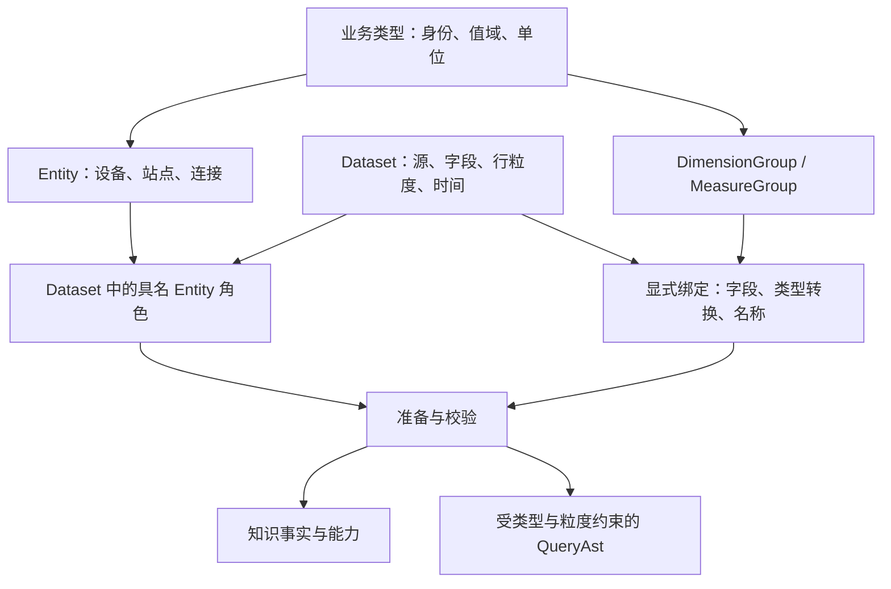

# RFC 0002：以类型约束组合模型，显式区分 Entity 与 Dataset

状态：已接受为探索方向，先推进阶段 A 原型；公共 API 与后续阶段继续评审。日期：2026-10-23。

## 目标

让模型作者借助 Telora 的名义类型、参数化类型与构造校验表达业务约束，通过显式映射复用维度和度量。
首先在 `relation_model` 中探索作者体验与语义边界，再确定公共 API、知识契约与查询协议的演进。

本 RFC 提供未来建模的具体图景。文中的新 `model::` API 是提案记法，不是已实现接口，也不要求 Telora 增加同名语法。
本文不改变当前 `ontology`、IC 模型、服务协议或部署环境。

## 已确认的方向与待验证的方案

讨论已确认以下方向：

- 显式区分 Entity 与 Dataset，二者是独立的一等概念
- 更多借助类型系统表达约束和复用，采用 Telora newtype 承载业务类型身份
- 单位参与运算合法性检查和结果类型推导
- DimensionGroup 与 MeasureGroup 可以组合复用，应用到具体 Dataset 时允许显式配置映射

本文提出的 Entity 角色、Group 输入端口、绑定方式和实验顺序仍需评审。
Group 是否进入公共知识图、Entity 是否拥有属性定义、查询如何选择描述同一 Entity 的不同 Dataset，仍是开放设计问题。

## 问题与当前基础

当前声明以带注解的 Telora struct 为中心。`@entity_id`、`@entity_source`、`@dataset`、字段维度与度量，以及具名关系共同准备为 `PreparedPayload`。
已有 `DatasetKind` 分类和类型化字段引用，但业务对象身份、物理记录、字段能力仍集中在这套数据集声明中。

`relation_model` 中 `Device` 同时描述设备对象、`devices` 表、复合身份、可查询维度和计数。
网络设备与其他类型设备若使用不同物理字段，需要分别声明相似的维度和度量。当前度量单位使用可选字符串，不能仅由这个字符串获得量纲计算规则。

未来希望把四件事分别表达清楚：

| 层次 | 回答的问题 | 例子 |
| --- | --- | --- |
| 业务类型 | 什么值，允许什么操作 | DeviceId、Bytes、Seconds |
| Entity | 什么业务对象，如何识别 | 设备，由租户与设备 ID 共同识别 |
| Dataset | 什么记录，每行代表什么 | 设备台账、设备计数器采样 |
| Group 与绑定 | 哪组能力可复用，输入来自哪里 | 流量度量组，绑定采样列与单位转换 |

## 建模图景



以设备为例：设备 Entity 定义完整身份；台账 Dataset 提供一份当前记录；采样 Dataset 提供每设备每时刻的记录。
两个 Dataset 都绑定同一个设备 Entity，但各自声明行粒度、时间和可查询能力。查询选择哪个 Dataset，必须有明确依据。

### 第一步：用 newtype 定义身份和值

以下类型声明使用现有 Telora 语法：

```telora
type TenantId = struct(String);
type DeviceId = struct(String);
type SiteId = struct(String);
type ConnectionId = struct(String);

type DeviceIdentity = struct {
    tenant: TenantId,
    local: DeviceId,
};

type SiteIdentity = struct {
    tenant: TenantId,
    local: SiteId,
};
```

`DeviceId` 与 `TenantId` 没有隐式互转，二者与 String 之间也没有隐式包装或解包。
`DeviceId` 表示租户内设备编号的业务类型；完整设备身份是 `DeviceIdentity`，其中包含租户。
两个租户中相同的 local 值代表不同设备。名义类型区分编号种类，复合身份约束负责命名空间完整性。

源字段为 String 时，需要一个显式的源解码／绑定边界赋予其业务类型。普通 String 字段不能仅因名称相同就被推断为 DeviceId。
类型不能证明数据库实际唯一、引用一定存在或租户值一定一致，这些仍是可信模型声明与数据验收的职责。

### 第二步：独立声明 Entity

以下为候选 API 示意：

```text
Tenant = Entity {
  id: "tenant",
  identity: TenantId
}

Device = Entity {
  id: "device",
  identity: DeviceIdentity
}

Site = Entity {
  id: "site",
  identity: SiteIdentity
}
```

Entity 不持有 SQL 表名，不预设由哪个 Dataset 完整描述自己，也不因拥有身份而自动获得查询入口。
告警若具有稳定身份和生命周期，也可以声明为 Entity；事件记录集仍是单独的 Dataset。

### 第三步：让 Dataset 显式绑定 Entity 角色

```text
DeviceInventory = Dataset {
  id: "device_inventory",
  source: "devices",
  fields: {
    tenant_id: TenantId <- decode String column "tenant_id",
    id: DeviceId        <- decode String column "id",
    site_id: Option(SiteId) <- decode nullable String column "site_id"
  },
  grain: [tenant_id, id],
  roles: {
    device: Device <- {tenant: tenant_id, local: id},
    site: Optional(Site) <- {tenant: tenant_id, local: site_id}
  }
}

DeviceCounters = Dataset {
  id: "device_counters",
  source: "device_counters",
  grain: [tenant_id, device_id, ts],
  roles: {
    device: Device <- {tenant: tenant_id, local: device_id}
  },
  fields: {
    tenant_id: TenantId,
    device_id: DeviceId,
    ts: DatetimeUtc,
    rx_bytes: Bytes,
    elapsed_ms: Milliseconds
  }
}
```

字段顺序仅为展示，绑定必须在模型准备前解析完整；第二个示例省略逐列解码配置。
实验新增的采样源是合成夹具，不将它描述为现有 relation 模型或 IC 元数据中已经存在的表。

`DeviceInventory` 的一行描述一个设备，`DeviceCounters` 的一行描述一个设备的一次采样。
设备角色不是采样行身份；不能把采样行数直接解释为设备数。没有已声明全行粒度的 Dataset 仍可支持有依据的行查询，但不能取得依赖该证明的能力。

可选角色在完整身份所有成员均非空时才可用；任一成员为空代表角色缺席，不创建“NULL 实体”。
角色映射只描述记录涉及哪个对象，不证明对象在某台账中存在，也不自动授权连接。

Dataset 可以绑定多个不同或同类 Entity，也可以不绑定 Entity，例如匿名统计汇总。
若两个 Dataset 声称描述同一个 Entity，准备阶段能校验身份类型与映射完整性；其数据一致性和时态一致性仍需额外声明与验收。

### 第四步：定义可复用的 DimensionGroup

```text
ResourceIdentityDimensions(E) = DimensionGroup {
  requires: role subject: E,
  members: {
    identity: subject 的完整身份投影
  }
}

ResourceLabelDimensions = DimensionGroup {
  inputs: {name: String, category: ResourceCategory},
  members: {
    name: Dimension(name, projectable, filters=[Eq, Contains]),
    category: Dimension(category, projectable, filters=[Eq])
  }
}
```

台账绑定示例：

```text
DeviceInventory.use(ResourceIdentityDimensions(Device), {
  subject: roles.device,
  publish: {identity: ["device_tenant_id", "device_id"]}
})

DeviceInventory.use(ResourceLabelDimensions, {
  inputs: {name: fields.display_name, category: fields.device_class},
  publish: {name: "device_name", category: "device_class"}
})
```

Group 的输入名称、业务成员名称、具体发布 ID 与物理列名分别管理。
完整身份投影对复合身份展开为多个有序成员，不能把它缩成单列；具体公共表示需由实验确定。
另一种分类不能只因底层也是 String 就绑定 ResourceCategory，需要显式、可校验的转换；不提供任意按标签猜测的映射。

没有分类的 Dataset 可以只使用身份组或较小的名称组。优先通过小 Group 组合表达差异；可选输入必须有明确的缺失语义，不能静默删除成员。

### 第五步：以单位类型约束 MeasureGroup

以下是候选库类型，采用 Telora 参数化 newtype 的形状：

```telora
type Quantity(Meaning, Unit, Rep) = struct(Rep);
```

Meaning 表达测量对象或业务数量种类，Unit 表达量纲、尺度与允许的换算，Rep 表达基础表示。
具体设计需要验证 Telora 对这些类型参数的反射与约束能力；仅有类型参数尚不能自动推导单位代数。
Bytes、Seconds 等名称在下文代表已选定的具体数量类型，最终使用类型族应用还是具名外包装由实验决定。

```text
TransferMeasures = MeasureGroup {
  inputs: {
    amount: Bytes,             // 本采样区间内传输的数据量
    elapsed: Seconds          // 相同采样区间内的有效时长
  },
  row_values: {
    rate: amount / elapsed -> BytesPerSecond
  },
  members: {
    amount_total: Sum(amount),
    rate_peak: Max(rate),
    rate_mean: Avg(rate)
  }
}

DeviceCounters.use(TransferMeasures, {
  inputs: {
    amount: fields.rx_bytes,
    elapsed: milliseconds_to_seconds(fields.elapsed_ms)
  },
  publish: {
    amount_total: "rx_bytes_total",
    rate_peak: "rx_rate_peak",
    rate_mean: "rx_rate_sample_mean"
  }
})
```

Group 固定聚合及统计意义，绑定适配字段和单位。`rate_mean` 是逐采样速率的算术平均，不能改称区间总体平均速率。
若要定义 `Sum(amount) / Sum(elapsed)`，应单独声明度量，并给出样本区间不重叠、有效时长等总体前提；计数器累计读数也不能冒充区间传输量。
固定 amount_total 的 Sum 并不自动授权任意跨连接聚合，查询仍需证明样本粒度未被扩增。

同一 Group 可以映射另一个 Dataset 的 `bytes_in`、`duration_seconds`，得到同样的业务计算。
两次绑定的成员拥有各自 Dataset 限定身份，不能因为来自同一 Group 就自动连接或对齐结果。

## 类型如何表达可计算性

### 语言能力与 ontology 责任

Telora 当前支持 `type A = struct(B)` 的名义身份、显式构造与解包、参数化类型族，以及 `@check` 构造校验。
JSON codec 对 newtype 使用载荷表示，成功解码后保留外层类型身份。语言依据见 Telora 的
`docs/design/LANGUAGE.md` 第 7 节与 `guide/TELORA.md` 的 newtype 说明；这些文档属于 Telora 项目，不在本仓复制维护。

ontology 需要提供业务类型与物理标量的显式表示映射，以及带输入／输出类型的封闭表达式构造器。
例如 `divide(BytesExpr, SecondsExpr) -> BytesPerSecondExpr` 表示待查询计算，而不是先读数据库值到 Telora 再计算。
普通 newtype 值运算可以验证类型方向，但不等于已经支持相应 SQL lowering。

首轮实验优先提供少量具名运算与转换，验证机制；通用量纲代数和自动选择换算路径留待后续设计。
不能依赖未核实的运算符重载、关联类型或编译期任意算术能力。

### 单位规则与业务规则

| 表达式 | 候选规则 |
| --- | --- |
| Bytes + Bytes | 返回 Bytes |
| Bytes + Kilobytes | 显式转换到共同单位后相加 |
| Bytes / Seconds | 返回 BytesPerSecond，明确零时长处理 |
| Watts × Seconds | 返回 Joules，业务意义还取决于功率值和区间定义 |
| Watts + Seconds | 拒绝，量纲不兼容 |
| CPU 利用率与内存利用率相加 | 单位兼容仍不足以授权运算，需要业务数量种类的规则 |
| 百分数 25 与比值 0.25 比较 | 经显式尺度转换后比较，不能只去掉 `%` 字符串 |

单位定义至少记录量纲、相对于选定基准的尺度及编码规则。KB 的 1000 与 KiB 的 1024 必须显式区分。
首轮支持线性尺度转换；摄氏温度等含偏移的单位、时间积分和采样插值留作后续主题，不以简单乘法近似。
声明合法单位的权威性来自模型作者，量纲和转换规则由库约束；类型系统不能从一个任意标签证明真实单位。

换算的整数溢出、精度损失、近似浮点计算和除零行为必须进入运算契约。实验以精确可表示的输入验证尺度，并为不支持的组合给出拒绝。
newtype 的构造检查可以约束百分比范围或非负时长，但不能单凭声明保证数据库已存数据有效。
数据库输入验收、参数解码、生成 SQL 和输出解码分别承担各自边界；完整结果集上的构造检查不能被客户端抽样代替。

### 聚合与空值

Min／Max 保留输入数量类型；Avg 与 Sum 保留业务数量和单位，但基础数值表示与溢出策略单独决定。
空聚合可能产生 NULL，结果类型必须保留这一可能，例如 `Option(BytesPerSecond)`；不能只因输入 newtype 非空就声明聚合结果非空。
Count 的值是数量，但计数主体、实体去重和记录计数仍需明确。单位不能证明任何聚合在业务上合理。

## Group 的组合与绑定边界

Group 定义输入端口的类型、成员 ID、表达式、聚合语义与能力上限；一次绑定给出输入映射、实体角色和输出成员的发布 ID。
输入可以是当前 Dataset 的带类型字段或封闭计算表达式。首轮不允许在绑定中隐式引入跨 Dataset 查询。

| 可配置项 | 约束 |
| --- | --- |
| 字段与角色映射 | 输入类型兼容，角色的完整身份成员齐全 |
| 单位或编码转换 | 使用显式受支持转换，保留转换事实 |
| 发布 ID、描述和标签 | ID 在所属命名空间唯一，标签不承担身份 |
| 能力裁剪 | 可降低允许的筛选／投影能力，不扩展 Group 或 Dataset 的上限 |
| Group 组合 | 成员显式合并与重命名，依赖可解析且无环 |

绑定不允许把 Avg 覆盖为 Max、把 Bytes 标成 Watts、把相同显示名当实体身份，或通过配置添加未声明关系。
不同聚合应成为显式成员或不同 Group。重复发布 ID、缺失端口、循环依赖与类型冲突都应定位到 Group 定义和绑定位置。
同一 Group 可以绑定两次，如接收／发送流量，前提是各次输入、成员身份和发布名称明确。

## 关系、角色与计数

关系需要区分业务对象关系与具体 Dataset 上的实现路径。首轮保留当前具名关系与可信基数契约，增加类型与角色校验。
不根据两列具有相同 newtype 就推断可以连接，也不根据完整身份连接键自动证明运行时基数。

relation 实验中的连接记录可表达为：

```text
ConnectionRecord {
  connection: Connection <- {tenant: tenant_id, local: id},
  a: Device <- {tenant: tenant_id, local: a_device_id},
  z: Device <- {tenant: tenant_id, local: z_device_id}
}

connected_device: Undirected(a, z)
upstream_device: Directed(a, z)   // 在独立 RouteRecord 上声明
```

A/Z 是具名 Entity 角色，二者同为 Device 类型，但角色身份不同；方向来自显式业务连接声明。
缺 tenant 的设备身份映射失败；把 SiteId 绑定到 DeviceId 端口失败。即使所有类型正确，反向遍历有向关系仍应拒绝。

同一 Entity 在多个 Dataset 中出现时，不选择隐式“主表”，不自动跨源合并、去重或取最新。
首轮实验请求保留明确 Dataset 实例与角色选择；实体检索、多来源融合和时态属性解析另行设计。
实体计数需要完整身份以及结果去重／粒度证明；记录计数需要 Dataset 行粒度。两者不能仅通过名称替换互相迁移。

## 准备、发现与查询边界

候选准备流程如下：

1. 注册业务类型、Entity、Dataset 和可复用 Group
2. 解析字段表示、完整身份、具名角色与关系，检查静态类型及声明一致性
3. 展开 Group 绑定，固定成员 ID、类型、单位转换及表达式依赖
4. 将语义描述降为可供查询和知识发现共享的准备模型
5. 转换具体查询时继续校验权限、关系、总体、粒度、时间与目标后端能力

编译器可证明的名义类型错误尽量在编译时拒绝；通过 Type 元数据和动态声明构造的错误在模型准备时拒绝；查询总体等依赖请求的错误在 Intent 转换时拒绝。
跨行唯一性、外键完整性、实际值域和声明基数由数据验收验证。诊断必须指出属于哪一个阶段，不能统称为“类型安全”。

知识发现需要表达 Entity 与 Dataset 的区别、角色的身份映射、数量类型、单位和转换，以及 Group 绑定后可查询的成员。
公共知识仍只发布可见成员；Group 的私有输入和隐藏身份不能因为组合而泄露。
Group 是否发布为可寻址节点仍待讨论；无论选择何种形态，查询所需的展开成员和计算语义必须可发现。

现有 QueryAst 采用封闭运算。新类型在准备和表达式构造期间保留语义，在后端渲染前形成带明确数值转换的受支持 AST。
不将任意 Telora Fn 或 SQL 字符串作为字段映射接受。每个后端需要执行验证，不能只凭类型签名声称已支持单位计算。

当前 JSON Intent 的基础值形状不因使用 newtype 就必然改变。身份角色、类型 ID、结果单位和 Dataset 选择若影响外部契约，须版本化设计后再迁移。
本 RFC 不提前决定新请求字段、知识键模式或兼容期，不把新 Entity ID 直接覆盖旧 Dataset ID。

## 用 relation_model 探索

### 阶段 A：类型基础与映射原型

在独立实验模块与测试中声明 TenantId、DeviceId、SiteId 和复合身份，验证语言已有的名义类型、JSON codec 与构造检查。
提出最小 Entity／Dataset／Role 描述与带类型字段映射；运行准备阶段的正反例，保留现有 relation 服务和测试作为基线。

### 阶段 B：Group 与单位计算

新增小型合成计数器采样夹具，两个 Dataset 使用不同物理列名和秒／毫秒表示，绑定同一个 TransferMeasures。
DimensionGroup 先覆盖身份投影及可选的名称组；MeasureGroup 先覆盖逐行速率、Sum、Max 和 Avg。
验证 Group 的重复应用、成员命名、能力裁剪、可空性和单位转换；不从这项实验推导 IC 生产语义。

### 阶段 C：关系与端到端查询

把 Tenant、Site、Device、Connection、Route 的实验声明映射到当前五张关系模型表。
保留当前复合身份、有向／无向业务连接、EXISTS 粒度保护和空组计数语义。
以小型 SQLite 数据验证新声明和基线声明的等价查询结果，再逐步覆盖知识发现和结果模式。
试验稳定后单独提出公共契约和 IC 迁移方案；RFC 批准不等于已经批准替换演示环境。

### 验收图景

| 正例 | 对应反例或必须解释的边界 |
| --- | --- |
| 两个不同列名的 Dataset 绑定同一 Group，得到同义度量 | 输入缺失或名义类型错误，绑定失败 |
| 完整 DeviceIdentity 绑定设备角色 | 只给 DeviceId 或把 SiteId 用作 DeviceId，失败 |
| 相同本地编号的两个租户设备保持独立 | 按本地编号错误合并实体，不得通过 |
| Connection 的 a、z 各自绑定完整设备身份 | 同为 Device 类型不代表可交换有向角色 |
| 1000 Bytes / 1000 Milliseconds 经显式转换得 1000 BytesPerSecond | 未转换却把毫秒当秒，拒绝不兼容输入 |
| 逐样本速率 Avg 与总量／总时长得到各自正确结果 | 非均匀时长夹具中两种均值不同，不能混称 |
| 两次应用 Group 分别生成接收／发送指标 | 发布 ID 冲突、循环依赖或聚合被绑定覆盖，失败 |
| 缺席的可选站点角色保持缺席 | 用 NULL 身份建立共享站点，失败 |
| 空样本集上的 Avg 返回可空数量结果 | 将结果声明为必定非空，失败 |
| Typed Expr 经转换后生成参数化 SQL，执行结果单位正确 | 任意 Fn、原始 SQL 或未支持后端不得绕过校验 |
| 所有原 relation 验收继续成立 | 类型化声明不能放宽基数、方向或可见性约束 |

额外记录准备耗时、函数数、Wasm 代码段与快照大小。类型和 Group 展开可能增加专门化实例，性能结果要实测；本次设计不承诺自动缩小产物。

## 评审问题与实施顺序

建议先确认概念和作者体验，再收敛语法与实现：

1. Entity 只定义身份，还是也声明业务属性；属性由多个 Dataset 提供时如何区分来源与时间
2. Group 是声明复用工具，还是公开的一等知识概念；是否需要跨 Dataset 的 Group 成员稳定身份
3. 首轮数量类型采用具名类型加显式运算表，还是直接引入参数化 Quantity 与能力约束
4. 映射描述是否分别表示类型赋予、源解码、单位换算与纯计算，以便发现和诊断完整解释
5. 角色和 Entity 在公共查询中如何寻址，怎样避免自动选择数据源改变用户总体

建议首轮只落地可执行的 relation 原型，使用具名数量类型与少量显式转换验证端到端流程。
若现有 Telora 能力不足，先记录最小缺口；是否需要语言层演进另行论证，不在 ontology 中模拟未证明的类型系统能力。

本 RFC 单独交付。阶段 A 在独立实现分支推进，实验结论反馈到本文；后续阶段确认范围后继续实施。
各阶段按范围选择语言拒绝测试、模型准备测试及数据库执行验收，提交与合入遵循仓库交付规则。

## 参考

- [当前模型声明与准备契约](../ontology/docs/ONTOLOGY.md)
- [字段角色与唯一引用](../ontology/docs/FIELD-ROLES.md)
- [查询 AST 边界](../ontology/docs/QUERY.md)
- [逻辑类型](../ontology/docs/LOGICAL-TYPES.md)
- [relation 模型声明](../relation_model/src/model.telora)
- [relation 验收语义](../relation_model/ACCEPTANCE.md)

## 阶段 A 实验记录

统一跟踪议题为 [#64](https://github.com/hh9527/lab-ontology/issues/64)，各阶段在同一议题汇报，不另建阶段议题。

原型入口为 `ontology::experimental::model`，独立于当前 `ontology::ontology` 准备与服务协议。
可执行示例见 [relation 测试夹具](../relation_model/tests/typed_model/fixture.telora)，正反例见
[typed_model 测试](../relation_model/tests/typed_model.telora)。

作者可使用以下实际原型 API 表达映射：

```telora
use ontology::experimental::model as model;

type TenantId = struct(String);
type DeviceId = struct(String);
type DeviceIdentity = struct { tenant: TenantId, local: DeviceId };
type Inventory = struct { tenant: TenantId, device: DeviceId };

def device: model::Entity(DeviceIdentity) = model::entity("device", DeviceIdentity.type);
def inventory: model::Dataset(Inventory) = model::dataset(
    "inventory", "devices", Inventory.type, ["tenant", "device"]);
def subject: model::Role(Inventory) = model::role(inventory, device, "subject", False, [
    model::identity_part(model::field(Inventory.type, TenantId.type, "tenant"),
        model::field(DeviceIdentity.type, TenantId.type, "tenant")),
    model::identity_part(model::field(Inventory.type, DeviceId.type, "device"),
        model::field(DeviceIdentity.type, DeviceId.type, "local")),
]);
```

静态泛型签名约束字段值类型、Dataset 行类型和 Entity 身份类型；准备阶段检查字段存在、完整身份覆盖、重复成员、可空性和冲突角色。
同一个 Entity 可映射到不同字段名与行粒度的 Dataset，同一个 Dataset 可具有设备 a／z 两个角色，Dataset 也可不绑定 Entity。
newtype 的原始 JSON 编码与构造校验已经在这个模型上下文中验证；没有将其等同于数据库已有值的验收。

原型取舍与限制：

- 身份暂要求非空 record，成员为 Int、String 或它们的 newtype 包装；单值身份用一成员 record 表达，后续再验证直接 newtype 身份
- Dataset 粒度与实体身份分开，空 grain 表示没有声明全行身份；实验不据此授予计数能力
- `optional_field` 在类型化构造时要求精确的 `Option(Value)`；角色描述擦除类型参数后，准备层按 None／Some 的完整结构检查可空输入
- 原型的公开 record 不是不可伪造证明；手写声明仍经过准备校验，后续完善擦除边界的表示与名义 Option 证据
- `prepare` 只处理单个 Dataset，跨 Dataset 的 Entity 注册和一致性校验留待组合准备阶段
- 本阶段只准备模型事实，不生成知识节点、查询 AST、SQL，也不迁移现有关系模型服务

`scripts/check-typed-model-rejections.py` 在独立临时工作区运行合法控制例和编译期拒绝例，覆盖名义值、映射值类型、行拥有者、实体身份和单位运算。
失败源码不加入普通测试发现路径，因此正常的 `check --tests` 不会因预期编译失败夹具而失败。

## 阶段 B 单位计算实验

实际入口为 `ontology::experimental::quantity`，当前以具名 newtype 和封闭的函数签名验证单位计算，尚未实现通用量纲代数。

```telora
use ontology::experimental::quantity as q;

# 显式换算后，结果为 Some(BytesPerSecond(1.5))
q::rate(q::Bytes(3.0), q::seconds(q::Milliseconds(2000.0)))
```

`rate(Bytes, Seconds)` 返回 `Option(BytesPerSecond)`，毫秒直接传入、字节与秒相加、将速率结果声明为字节都会在编译期拒绝。
数量使用 Float 负载，JSON 保留数值表示；物理源数据的单位真实性仍需在 Dataset 绑定边界验证。

实验明确两个聚合口径：`mean_rate` 是有效样本速率的算术平均，`weighted_rate` 是有效样本累计量除以累计时长。
例如 `(100 B, 1 s)`、`(900 B, 9 s)`、`(100 B, 10 s)` 分别得到 `70 B/s` 和 `55 B/s`。
非正时长样本在这两个实验聚合中都排除，空集或全无效样本返回 None；有效时长上的零字节仍得到零速率。

这部分确定了单位与聚合语义的最小可执行基础。阶段 B 仍需继续完成 Group 定义／绑定、成员命名映射、封闭表达式到查询 AST 的 lowering 和实际 SQLite 计算验收。
